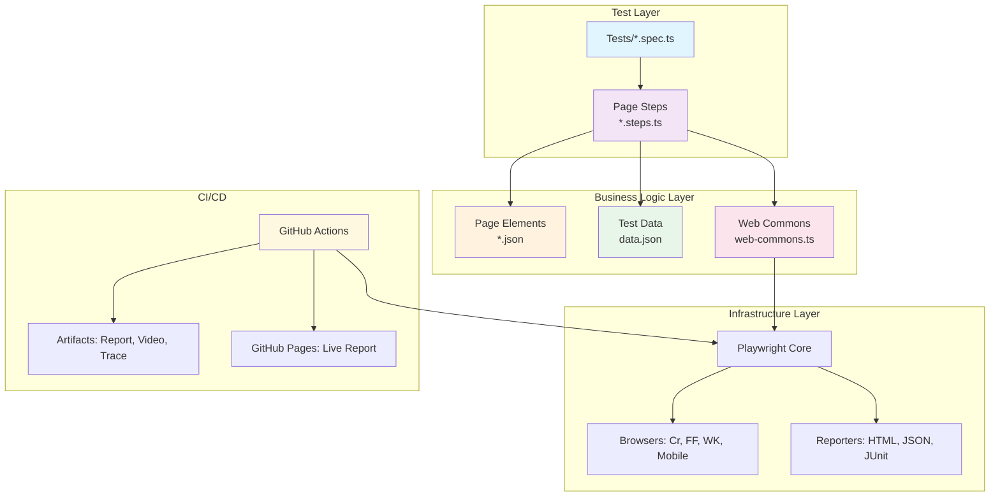

# 🤖 AI-Powered Playwright Test Automation Framework

[](https://github.com/Suraj7-qa/ai-test-automation-playwright/tree/main/tests)
[]()
[]()
[](https://nodejs.org)
[](https://playwright.dev)
[](https://typescriptlang.org)
[](.github/workflows)
[]()

> **Built with GitHub Copilot** • **AI-Assisted Development** • **Production-Ready**

---

## 🎯 Project Overview

| Metric | Value |
|--------|-------|
| **Framework** | Playwright + TypeScript |
| **Architecture** | Page Object Model (JSON + TS) |
| **Test Suites** | 7 Modules |
| **Test Cases** | 169+ (Smoke, Regression, Negative, Edge Cases) |
| **Browsers** | Chromium, Firefox, WebKit, Mobile Chrome, Mobile Safari |
| **CI/CD** | GitHub Actions (Multi-browser, Parallel) |
| **Reports** | HTML, JSON, JUnit, Allure-ready |
| **AI Tools** | GitHub Copilot, Copilot Chat, Copilot Edits |

---

## 🏗️ Architecture



---

## 📊 Test Coverage Dashboard

### Complete Module Coverage (169+ Tests)
| Module | Test Files | Test Cases | Test Count | Key Tags |
|--------|------------|------------|------------|----------|
| 🔐 **Authentication** | 4 | 15 TCs | 48 | `@smoke @regression @critical @negative` |
| 📚 **Books** | 1 | 42 TCs | 42 | `@smoke @regression @negative` |
| 💻 **Computers** | 1 | 17 TCs | 17 | `@smoke @regression @critical` |
| 📱 **Electronics** | 1 | 5 TCs | 5 | `@smoke @regression` |
| 🧭 **Navigation** | 2 | 57 TCs | 57 | `@smoke @regression` |
| **TOTAL** | **9** | **136 TCs** | **169** | |

### Authentication Module Detail (48 Tests)
| Flow | Test Case IDs | Tests | Tags |
|------|---------------|-------|------|
| **Login** | DWS-TC-0006–0010, 0014 | 15 | `@smoke @regression @critical @negative` |
| **Register** | DWS-TC-0001–0005, 0015 | 19 | `@smoke @regression @negative` |
| **Password Recovery** | DWS-TC-0012–0013 | 8 | `@regression @negative` |
| **Logout** | DWS-TC-0011 | 6 | `@smoke @regression` |

### Catalog Modules Detail
| Module | Test Case IDs | Tests | Coverage |
|--------|---------------|-------|----------|
| **Books** | DWS-BOOKS-001–042 | 42 | Category, Product Detail, Cart, Email Friend, Compare, Reviews, Sort, Display, Price Filter, Breadcrumbs, Navigation, Search |
| **Computers** | DWS-COMP-002–024 | 17 | Subcategories, Desktop/Notebook/Accessories Catalog, Sort, Filters (Price, CPU, RAM), RAM Price Change, Configured Desktop Add to Cart, Cart Persistence |
| **Electronics** | ELEC-003, 030–032 | 5 | Category Access, Subcategory Links, Camera/Photo Price Filters (Under/Over 500) |

### Navigation Module Detail (57 Tests)
| Area | Test Case IDs | Tests | Coverage |
|------|---------------|-------|----------|
| **Header Menu** | DWS-NAV-001–015 | 15 | All 7 Main Categories, 3 Computers Sub-categories, Top Links (Register, Login, Cart, Wishlist), Logo |
| **Sidebar** | DWS-NAV-016–020 | 5 | Categories Expansion, Sub-category Navigation, All Categories Present, Manufacturers/Newsletter Sections |
| **Footer** | DWS-NAV-021–038 | 18 | Information, Customer Service, My Account, Follow Us (Social + nopCommerce) |
| **Search** | DWS-NAV-039–041 | 3 | Valid/Invalid/Empty Search |
| **Breadcrumbs** | DWS-NAV-042–044 | 4 | Category/Sub-category Breadcrumbs, Home Navigation |
| **Cross-Module** | DWS-NAV-045–047 | 3 | Category Hopping, Cart Persistence, Session Persistence |
| **Auth Navigation** | DWS-TC-0014–0015 + nav | 9 | Login↔Register↔Recovery↔Home Cycles |

---

## 🚀 Quick Start

```bash
# 1. Clone & Install
git clone https://github.com/Suraj7-qa/ai-test-automation-playwright.git
cd ai-test-automation-playwright
npm install

# 2. Install Browsers
npx playwright install

# 3. Configure Environment
cp .env.example .env
# Edit .env with your credentials

# 4. Run Tests
npm test                    # All 169 tests (headless)
npm run test:ui            # UI tests only
npm run test:headed        # Watch browser
npm run test:debug         # Debug mode
npm run test:report        # View HTML report
```

---

## 🏷️ Test Tags & Filtering

```bash
# Run smoke tests (critical path ~30 tests)
npx playwright test --grep @smoke

# Run regression suite (all 169 tests)
npx playwright test --grep @regression

# Run negative tests only
npx playwright test --grep @negative

# Run business critical tests
npx playwright test --grep @critical

# Run specific module
npx playwright test tests/ui/login.spec.ts
npx playwright test tests/ui/books.spec.ts
npx playwright test tests/ui/computers.spec.ts
npx playwright test tests/ui/electronics.spec.ts
npx playwright test tests/ui/navigation.spec.ts

# Run specific test case
npx playwright test tests/ui/login.spec.ts -g "DWS-TC-0006"
npx playwright test tests/ui/books.spec.ts -g "DWS-BOOKS-009"

# Run on specific browser
npx playwright test --project=firefox
npx playwright test --project=mobile-chrome
```

---

## 📁 Project Structure

```
ai-test-automation-playwright/
├── .github/
│   └── workflows/
│       └── playwright.yml          # CI/CD Pipeline (5-browser matrix)
├── config/
│   └── config.json                 # Framework config
├── commons/
│   ├── ui/
│   │   ├── web-commons.ts          # Reusable UI actions
│   │   └── index.ts
│   └── api/
├── page-objects/
│   ├── page-elements/              # 🎯 Locator Definitions (JSON)
│   │   ├── login-page.json
│   │   ├── register-page.json
│   │   ├── home-page.json
│   │   ├── password-recovery-page.json
│   │   ├── books-page.json
│   │   ├── book-product-detail-page.json
│   │   ├── computers-page.json
│   │   ├── electronics-page.json
│   │   ├── cart-page.json
│   │   └── checkout-page.json
│   ├── page-steps/                 # ⚡ Business Actions (TypeScript)
│   │   ├── login-steps.ts
│   │   ├── register-steps.ts
│   │   ├── home-steps.ts
│   │   ├── password-recovery-steps.ts
│   │   ├── books-steps.ts
│   │   ├── computers-steps.ts
│   │   ├── electronics-steps.ts
│   │   ├── cart-steps.ts
│   │   ├── checkout-steps.ts
│   │   └── index.ts
│   └── index.ts
├── testdata/
│   ├── ui/
│   │   └── data.json               # 📊 Test Data (all modules)
│   └── api/
├── tests/
│   ├── ui/
│   │   ├── login.spec.ts           # 15 tests
│   │   ├── register.spec.ts        # 19 tests
│   │   ├── logout.spec.ts          # 6 tests
│   │   ├── password-recovery.spec.ts # 8 tests
│   │   ├── navigation.spec.ts      # 47 tests
│   │   ├── navigation-module.spec.ts # 10 tests
│   │   ├── books.spec.ts           # 42 tests
│   │   ├── computers.spec.ts       # 17 tests
│   │   ├── electronics.spec.ts     # 5 tests
│   │   ├── cart.spec.ts            # (planned)
│   │   └── checkout.spec.ts        # (planned)
│   └── api/
├── docs/                           # 📚 Documentation
│   ├── index.md
│   ├── Test-Plan-E2E.md
│   ├── Traceability-Matrix.md
│   └── runbooks/
│       ├── local-execution.md
│       ├── ci-execution.md
│       └── debug-failures.md
├── utilities/
│   ├── element-loader.ts           # 🔧 Element loader
│   ├── test-data-loader.ts         # 📥 Data loader
│   └── index.ts
├── playwright.config.ts            # ⚙️ Playwright config
├── tsconfig.json                   # TypeScript config
├── package.json
├── .env.example
└── README.md
```

---

## 🎨 Page Object Model - Design Highlights

### 1. **Locator-First Approach (JSON)**
```json
// page-objects/page-elements/books-page.json
{
  "productList": {
    "locators": [
      { "type": "css", "value": ".product-grid .item-box" },
      { "type": "role", "value": "listitem" }
    ],
    "description": "Product items on Books category page"
  },
  "sortByDropdown": {
    "locators": [
      { "type": "css", "value": "#products-orderby" },
      { "type": "testid", "value": "sort-by-select" }
    ],
    "description": "Sort products dropdown"
  }
}
```

### 2. **Business Actions (TypeScript)**
```typescript
// page-objects/page-steps/books-steps.ts
export class BooksPageSteps {
  async addToCartFromCategory(productName: string): Promise<void> {
    await this.webCommons.click(this.getAddToCartButton(productName));
    await this.webCommons.waitForNotification('added to your shopping cart');
  }
  
  async sortBy(option: string): Promise<void> {
    await this.webCommons.selectOption(this.elements.sortByDropdown, option);
    await this.webCommons.waitForPageLoad();
  }
  
  async filterByPrice(range: string): Promise<void> {
    await this.webCommons.click(this.getPriceFilterRadio(range));
    await this.webCommons.waitForPageLoad();
  }
}
```

### 3. **Test Data Driven**
```json
// testdata/ui/data.json
{
  "validUser": {
    "email": "testuser@example.com",
    "password": "Password123!"
  },
  "books": {
    "products": {
      "computingAndInternet": { "name": "Computing and Internet", "price": "10.00", "oldPrice": "30.00" },
      "copyComputingInternet": { "name": "Copy of Computing and Internet EX", "price": "30.00" },
      "fiction": { "name": "Fiction EX", "price": "24.00" }
    },
    "priceFilters": ["Under 25.00", "25.00 - 50.00", "Over 50.00"]
  },
  "computers": {
    "desktops": { "basePrice": "1490.00", "ramOptions": ["2 GB", "4 GB", "8 GB"] }
  }
}
```

---

## 🔄 CI/CD Pipeline

```yaml
# .github/workflows/playwright.yml
name: 🧪 Playwright Tests

on:
  push:
    branches: [main, develop]
  pull_request:
    branches: [main]
  schedule:
    - cron: '0 2 * * *'  # Daily at 2 AM UTC
  workflow_dispatch:
    inputs:
      browser:
        type: choice
        options: [all, chromium, firefox, webkit, mobile-chrome, mobile-safari]
      tags:
        type: string
        description: 'Test tags (e.g., @smoke, @regression)'

jobs:
  lint-and-typecheck:
    runs-on: ubuntu-latest
    steps:
      - uses: actions/checkout@v4
      - uses: actions/setup-node@v4
        with: { node-version: '20', cache: 'npm' }
      - run: npm ci
      - run: npm run lint
      - run: npx tsc --noEmit

  test:
    needs: lint-and-typecheck
    runs-on: ubuntu-latest
    strategy:
      fail-fast: false
      matrix:
        project: [chromium, firefox, webkit, mobile-chrome, mobile-safari]
    steps:
      - uses: actions/checkout@v4
      - uses: actions/setup-node@v4
        with: { node-version: '20', cache: 'npm' }
      - run: npm ci
      - run: npx playwright install --with-deps ${{ matrix.project }}
      - run: npx playwright test --project=${{ matrix.project }}
      - uses: actions/upload-artifact@v4
        if: always()
        with:
          name: playwright-report-${{ matrix.project }}
          path: playwright-report/
          retention-days: 14

  test-summary:
    needs: test
    if: always()
    runs-on: ubuntu-latest
    steps:
      - uses: actions/download-artifact@v4
        with: { path: all-reports, pattern: playwright-report-* }
      - run: |
          echo "## 🧪 Test Summary" >> $GITHUB_STEP_SUMMARY
          # Generate markdown table of results
```

### Pipeline Features
- ✅ **5-Browser Matrix** (Desktop + Mobile)
- ✅ **Parallel Execution** (fullyParallel: true)
- ✅ **Retries on CI** (2 retries for flakiness)
- ✅ **Artifacts** (HTML, Videos, Traces, Screenshots)
- ✅ **Scheduled Runs** (Daily 2 AM regression)
- ✅ **PR Checks** (Block merge on failure)
- ✅ **Manual Dispatch** (Custom browser/tags)
- ✅ **GitHub Pages Deploy** (Live HTML report)

---

## 📈 Live Reports

| Report | Access |
|--------|--------|
| 📊 **HTML Report** | `npm run test:report` or [GitHub Pages](https://suraj7-qa.github.io/ai-test-automation-playwright/) |
| 📹 **Videos** | `test-results/` (on failure) |
| 🔍 **Traces** | `test-results/` (on first retry) |
| 📋 **JUnit XML** | `test-results/results.xml` (CI integration) |
| 📊 **JSON Results** | `test-results/results.json` (Custom dashboards) |
| 📋 **PR Summary** | Auto-comment on every PR |

---

## 🛠️ Tech Stack

| Category | Tools |
|----------|-------|
| **Testing** | Playwright 1.45+, TypeScript 5.5 |
| **Architecture** | Page Object Model, JSON Locators |
| **Data** | JSON-driven, Environment-based |
| **CI/CD** | GitHub Actions, Multi-browser matrix |
| **Reporting** | HTML, JSON, JUnit, Allure-ready |
| **AI Assistance** | GitHub Copilot, Copilot Chat, Copilot Edits |
| **Code Quality** | ESLint, TypeScript strict mode |

---

## 🎯 Skills Demonstrated

- ✅ **Test Architecture** - Scalable POM with separation of concerns
- ✅ **Locator Strategy** - Resilient selectors (data-testid → ARIA → CSS)
- ✅ **Data-Driven Testing** - External test data, environment configs
- ✅ **Cross-Browser Testing** - 5 browser projects including mobile
- ✅ **CI/CD Engineering** - GitHub Actions, artifacts, scheduling, Pages
- ✅ **AI-Assisted Development** - Copilot for generation, refactoring, docs
- ✅ **Documentation** - Comprehensive README, runbooks, test plans
- ✅ **Best Practices** - Retries, timeouts, parallel execution, cleanup

---

## 📚 Documentation

| Document | Description |
|----------|-------------|
| [📖 Docs Index](./docs/index.md) | Overview & Navigation |
| [📋 Test Plan](./docs/Test-Plan-E2E.md) | Strategy, Scope, Schedule, Risks |
| [🔗 Traceability Matrix](./docs/Traceability-Matrix.md) | Requirements ↔ Test Cases |
| [🏃 Local Execution](./docs/runbooks/local-execution.md) | Run locally (headed, debug, tags) |
| [🔄 CI/CD Execution](./docs/runbooks/ci-execution.md) | GitHub Actions, GitLab, Azure DevOps |
| [🐛 Debug Failures](./docs/runbooks/debug-failures.md) | Flaky tests, locators, common issues |

---

## 🤝 Contributing

1. Fork the repository
2. Create feature branch (`git checkout -b feature/amazing-feature`)
3. Commit changes (`git commit -m 'Add amazing feature'`)
4. Push to branch (`git push origin feature/amazing-feature`)
5. Open Pull Request

---

## 📄 License

MIT License - see [LICENSE](LICENSE) for details.

---

## 👨‍💻 Author

**Suraj Navgire** - QA Automation Engineer  
🔗 [GitHub](https://github.com/Suraj7-qa) • [LinkedIn](https://linkedin.com/in/surajnavgire) • ✉️ surajnavgire092@gmail.com

---

<div align="center">

**⭐ Star this repo if you find it useful!**

*Built with ❤️ and Claude Code & GitHub Copilot*

</div>
